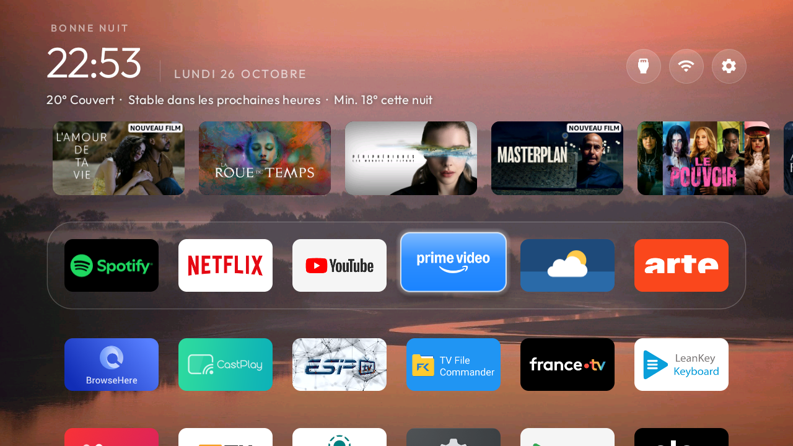

# Previews on the dock and weather under the clock

A fork of [cleanyourtv](https://github.com/Gathin23/cleanyourtv)'s launcher, branch `my-tv`, built and tested on a
**Telefunken SWTV-24AE-FHD** (Skyworth OEM, `beomil`, MediaTek mt5867, Google TV 14, about 930 MB RAM).
In daily use on that TV since 26 October 2026 with no crash or freeze.



## What it adds

Both are off unless a theme turns them on, and with them off the launcher behaves, and stays offline, as upstream.

| Theme key | What it does |
|---|---|
| `"top_shelf": true` | While a dock app is focused, a row of its programs appears above the dock: its Continue watching (Watch Next) and its preview channels, as the apps publish them for Google TV's home. Up enters the row, OK opens the program through the link the app stored, Down or Back returns to the dock. |
| `"shelf_hidden_apps": [...]` | Packages whose rows the shelf leaves out, for apps that publish only promotions. |
| `"weather_line": true` with `"weather_latitude"` and `"weather_longitude"` | One line under the clock: now, the next hours (rain likely around a time, or where the temperature goes) and the night's low or the day's high. English and French. |

```json
{
  "top_shelf": true,
  "shelf_hidden_apps": ["com.google.android.youtube.tv", "com.spotify.tv.android"],
  "weather_line": true,
  "weather_latitude": "48.8566",
  "weather_longitude": "2.3522"
}
```

The shelf needs `READ_TV_LISTINGS` to see other apps' rows. The launcher asks for it once; or grant it over ADB:
`adb shell pm grant com.gathin.tvhome android.permission.READ_TV_LISTINGS`.

## Network and permissions

This fork adds `INTERNET`, `READ_TV_LISTINGS` and `READ_EPG_DATA`. With the keys above on, it goes online for two
things only:

- **Poster pictures** the apps published for their programs, `https://` only, kept in a 6 MB memory cache while the
  row is on screen. Nothing is written to disk and nothing else is sent.
- **Open-Meteo** (`api.open-meteo.com`, no key, no account) for the weather line: only the latitude and longitude
  from the theme, every 30 minutes while Home is on screen.

No analytics and no other hosts. Cleartext traffic stays off.

## What the apps publish, on this TV

Netflix shows its Continue watching; Prime Video, ARTE and France.tv publish their own picks. YouTube and Spotify
publish rows that read as generic rather than the account's own, which is why the example hides them. Details:
`docs/watch-next.md` upstream.

## Credit and changes

The shelf is [PR #363](https://github.com/Gathin23/cleanyourtv/pull/363) by
[bjrb20](https://github.com/bjrb20), which upstream kept out of the reference launcher because it needs network
access. This fork ports it onto the current launcher and adds: a fallback to all of an app's channels when none is
marked browsable (every channel once Google TV's home is disabled), a guard against work landing after the activity
is destroyed, no shelf while reordering or editing the dock, a refusal of program links into the launcher itself,
a decode size cap, `https`-only posters, release on memory pressure, Back to leave the row, and Left/Right that
step along the top bar while the row shows. The weather line is new.

Commits on `my-tv`, oldest first, on top of upstream `5ee685b` (25 October 2026). Build and install as upstream:
`TV_HOST=<tv ip> HOME_KEY_SERVICE=1 launcher/build-and-install.sh`.

Issues: [this fork's tracker](https://github.com/Mehdi-Ks/cleanyourtv/issues).
